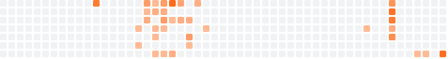

# Ahsan Mustafa

### Senior Data Engineer · ML Researcher

**Data platforms that hold up in production. Research that ships.**

 

I've spent six years building data platforms for fintech and healthcare: CDC streaming, lakehouses, and the pipelines behind them. I led a team of six data engineers along the way. In 2023 I moved to Moscow to go deeper into machine learning, which turned into an MSc at NUST MISIS (Red Diploma) and two published papers on detecting road defects from drone imagery.

Now I sit where those two meet: data systems built well enough that models can actually be trusted on top of them.

 

## Selected work

| | |
|---|---|
| **Real-time financial CDC pipeline** Postgres WAL → CDC → Kafka → Spark → Delta Lake (Bronze, Silver, Gold) → Redshift | Streaming change data from a fintech client's core database into a medallion lakehouse with alerting. [Case study →](https://iahsanmustafa.com/blog/financial-cdc-streaming-pipeline) |
| **Road defects from the sky** YOLO · PyTorch · GeoTIFF · A100 | My MSc research. Detection on UAV orthophotos with GSD-adaptive tiling, mAP50 from 55% to 86%. Two papers. [Case study →](https://iahsanmustafa.com/blog/road-defects-from-the-sky) |
| **[Carbon vs. Capital](https://github.com/Ahsan221B/Carbon-vs-Capital)** Azure Data Factory · Databricks · Snowflake · Power BI | Links corporate emissions data to US-listed companies, end to end from ingestion to dashboard. |
| **Personal AI agent** n8n · LangChain · Telegram Bot API | A multi-tool agent built for School 21, with notes on what I'd change for production. [Case study →](https://iahsanmustafa.com/blog/n8n-personal-ai-agent) |

## Research

- **YOLO26 for road defect detection on UAV imagery**, presented at DLCP 2026
- **Pavement defect detection with YOLO**, published in *Light & Engineering*

Graduate Research Associate at NUST MISIS (2024 to 2026), AI-driven infrastructure inspection, in collaboration with HSE. Full list on [Google Scholar](https://scholar.google.com/citations?user=DPbmpGUAAAAJ&hl=en).

## Toolbox

Also: Spark · Databricks · Snowflake · Delta Lake · Redshift · Airflow · dbt · YOLO · LangChain · n8n

## Activity

## Latest writing

<!-- BLOG-POST-LIST:START -->
- [Streaming financial transactions with CDC, Kafka and Spark](https://iahsanmustafa.com/blog/financial-cdc-streaming-pipeline)
- [Don&#39;t let the LLM count: fixing a job-skills digest](https://iahsanmustafa.com/blog/dont-let-the-llm-count)
- [Road defects from the sky: from a benchmark to a map in QGIS](https://iahsanmustafa.com/blog/road-defects-from-the-sky)
- [Building a personal AI agent on n8n: four workflows, one bot](https://iahsanmustafa.com/blog/n8n-personal-ai-agent)
<!-- BLOG-POST-LIST:END -->

 

Open to senior data engineering and ML roles worldwide · remote or relocation

